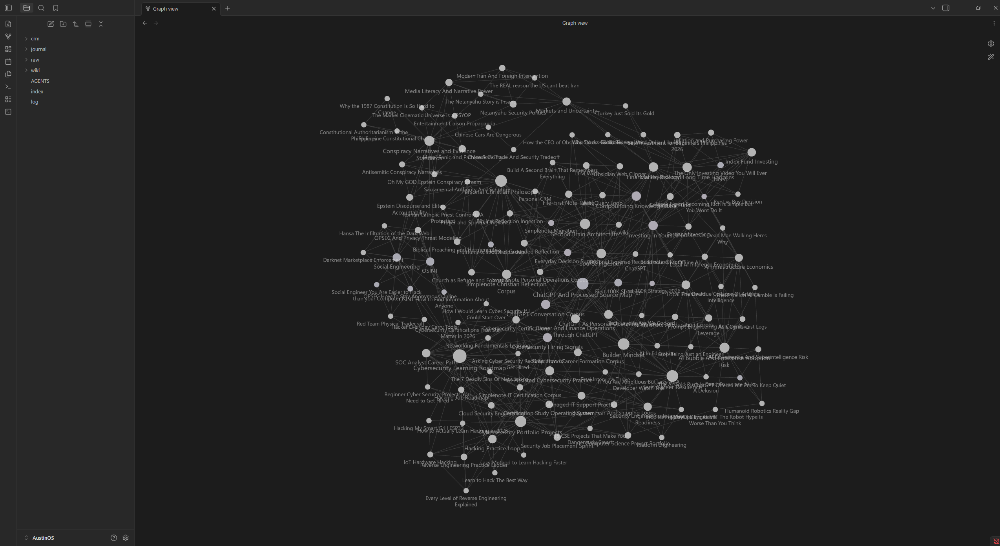
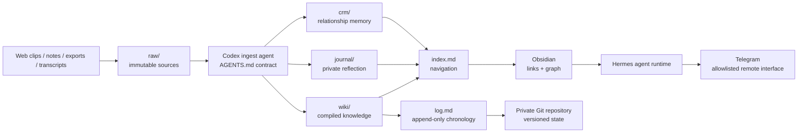
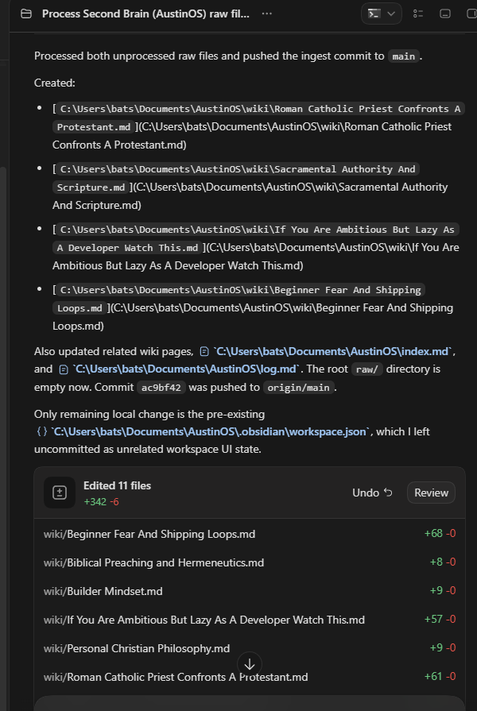
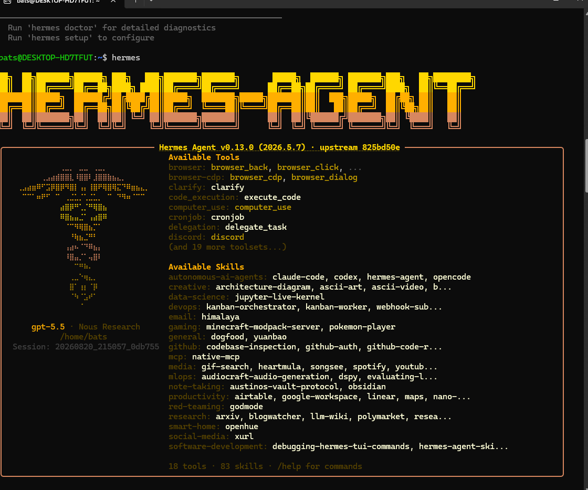
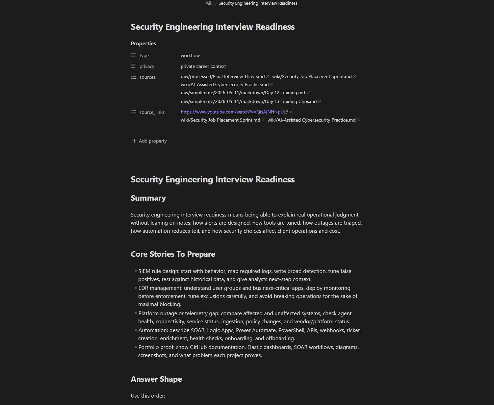

# My Second Brain

> A file-first, agent-maintained knowledge system by **Austin BC**.

My Second Brain is the public engineering case study for **AustinOS**, my private production knowledge vault. The system combines Obsidian, Codex automations, Git version control, and a Hermes agent gateway to turn raw source material into a durable, queryable, and continuously maintained knowledge graph.

This repository intentionally contains architecture, sanitized configuration, reference scripts, operational evidence, and implementation notes—not the private journal, CRM, conversations, credentials, or raw source corpus from AustinOS.



## What the system does

AustinOS treats personal knowledge as a maintained software system rather than a passive notes folder:

1. New material lands in an immutable `raw/` source layer.
2. An agent reads the source and follows the operating contract in `AGENTS.md`.
3. Source summaries and reusable concept, entity, workflow, synthesis, or comparison pages are created in `wiki/`.
4. New pages are connected with Obsidian links and grounded with original-source and raw-note provenance.
5. `index.md` is refreshed as the content-oriented navigation surface.
6. `log.md` receives an append-only record of the ingest or maintenance event.
7. The result is committed to the private AustinOS Git repository.
8. Hermes provides an agent runtime and messaging gateway, including an allowlisted Telegram channel configuration for remote interaction.

## Operational proof

The production AustinOS snapshot documented in August 2026 contained:

| Signal | Observed scale |
|---|---:|
| Compiled wiki pages | 129 |
| Preserved raw/source files | 1,374 |
| ChatGPT conversations represented in the corpus | 473 |
| Full conversation Markdown renderings | 470 |
| Codex ingestion schedule | Daily at 23:00 Asia/Manila |
| Git history | Nine repository snapshots from initial vault through recurring ingests |
| Agent gateway | Hermes user service enabled and active |

These are point-in-time measurements from the private AustinOS repository, not hard-coded product limits.

## Architecture



The design separates four concerns:

- **Evidence:** immutable sources and canonical links.
- **Compilation:** agent-generated, cross-linked knowledge pages.
- **Navigation:** human-readable index and chronological log.
- **Access:** Obsidian locally, Git for state history, and Hermes for conversational access.

Read the full [architecture](docs/architecture.md) and [ingestion pipeline](docs/ingestion-pipeline.md).

## Repository map

```text
.
|-- .github/workflows/validate.yml     # CI for the public reference implementation
|-- docs/
|   |-- architecture.md                # Components, boundaries, and state transitions
|   |-- automation.md                  # Codex schedule and Git-safe execution model
|   |-- data-model.md                  # Raw, compiled, navigation, and private layers
|   |-- hermes-telegram.md             # Hermes gateway and Telegram channel design
|   |-- implementation-notes.md        # What was built, observed, and sanitized
|   |-- ingestion-pipeline.md          # Detailed lifecycle and failure handling
|   |-- privacy-model.md                # Public/private boundary and threat model
|   `-- screenshots.md                 # Evidence catalog
|-- examples/
|   |-- automation.example.toml        # Sanitized Codex automation definition
|   |-- hermes-config.example.yaml      # Secret-free Telegram/gateway shape
|   |-- hermes-gateway.service         # Persistent user-service template
|   `-- vault/                          # Minimal test vault
|-- scripts/
|   |-- check_markdown_links.py        # Repository-local documentation link checks
|   |-- snapshot_metrics.py            # Point-in-time vault inventory
|   |-- vault_audit.py                 # Provenance, links, index, and log checks
|   `-- public_preflight.py             # Secret/private-path release guard
|-- SECURITY.md
`-- README.md
```

## Reference tooling

The scripts use only the Python standard library.

```bash
python scripts/vault_audit.py examples/vault
python scripts/snapshot_metrics.py examples/vault
python scripts/check_markdown_links.py .
python scripts/public_preflight.py .
```

`vault_audit.py` checks:

- required vault directories and control files;
- wiki frontmatter fields;
- provenance sections;
- unresolved Obsidian links;
- index coverage;
- append-only log heading shape.

`public_preflight.py` rejects common secret patterns, private vault directories, private keys, credential files, and accidental AustinOS corpus copies before publication.

## Automation

The active Codex automation is configured with this schedule:

```text
RRULE:FREQ=WEEKLY;BYHOUR=23;BYMINUTE=0;BYDAY=SU,MO,TU,WE,TH,FR,SA
```

Although expressed as a weekly recurrence with all seven days selected, the effective behavior is **daily at 23:00 local time**. Each run checks for loose raw sources, performs the ingest contract, updates navigation and chronology, and commits/pushes only the relevant result when changes exist.

See [automation.md](docs/automation.md) for idempotency, dirty-worktree handling, network failures, and recovery behavior.

## Hermes and Telegram

The documented production environment includes:

- Hermes Agent v0.13.0;
- Python 3.11 runtime and isolated virtual environment;
- OpenAI Codex provider with GPT-5.5 selected at capture time;
- persistent `hermes-gateway.service` user service;
- messaging tools and `python-telegram-bot` dependency;
- a Telegram configuration section with `allowed_chats`, `channel_prompts`, and `reactions` controls;
- an AustinOS vault-protocol skill available to the agent.

Credentials, chat identifiers, device codes, environment files, and personal prompts are deliberately excluded. See [hermes-telegram.md](docs/hermes-telegram.md).

## Screenshots

| System surface | Evidence |
|---|---|
| Obsidian knowledge graph |  |
| Codex ingest execution |  |
| Hermes agent runtime |  |
| Compiled source-backed wiki |  |

Additional screenshots and their interpretation are cataloged in [screenshots.md](docs/screenshots.md).

## Security and privacy

The private AustinOS repository is the source system. It contains personal notes and other sensitive source material and is **not** suitable for public release. This repository uses a clean-room public boundary:

- no raw private corpus;
- no journal or CRM records;
- no exported conversations;
- no environment files, tokens, chat IDs, or device codes;
- no direct copy of private source content;
- only sanitized schemas, operational patterns, scripts, metrics, and screenshots approved for the case study.

Read [privacy-model.md](docs/privacy-model.md) and [SECURITY.md](SECURITY.md) before adapting this design.

## Provenance

- **Author:** Austin BC
- **Public project:** My Second Brain
- **Private production system:** AustinOS (`xntr99/AustinOS`, intentionally private)
- **Primary interface:** Obsidian
- **Knowledge compiler and maintenance agent:** Codex
- **Versioned state:** Git/GitHub
- **Conversational gateway:** Hermes with Telegram channel configuration

This repository is a public technical representation of the system. It does not claim that every reference script is an exact byte-for-byte export from the private vault; the scripts are sanitized, runnable equivalents of the operational contracts and checks used to maintain AustinOS.
