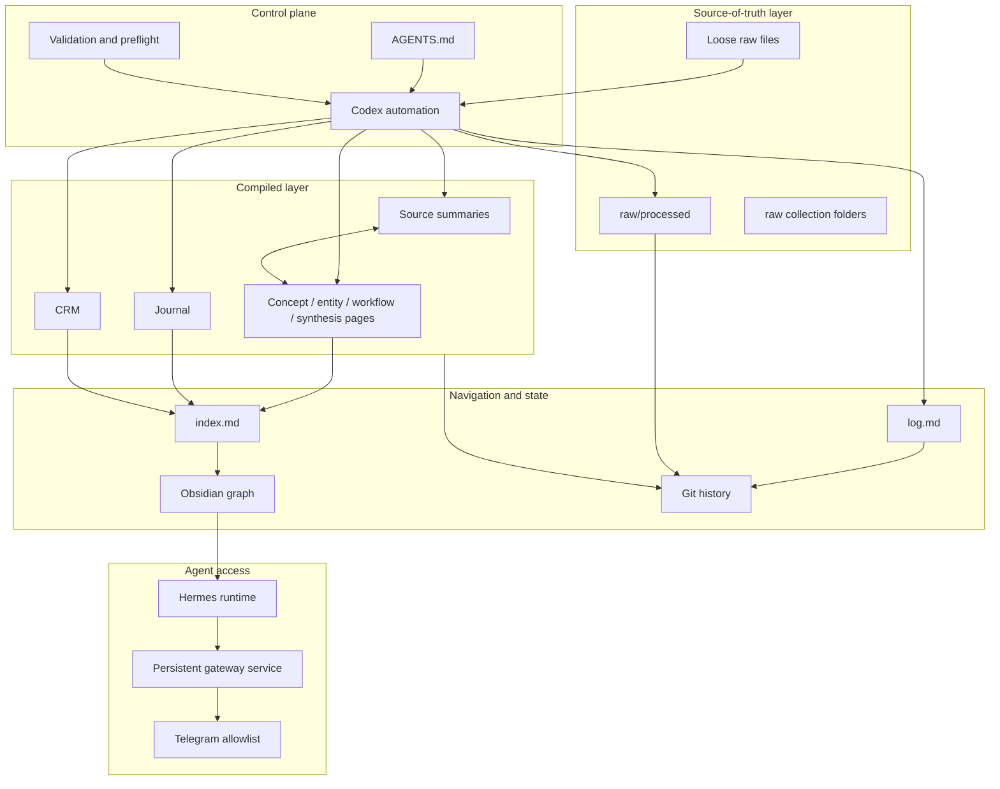

# System Architecture

## Design objective

MIMIR is designed as an intelligent second brain that makes accumulated information more useful over time. Its unit of value is not the captured source; it is the durable knowledge page that preserves evidence, explains mechanisms, records caveats, and connects to prior understanding.

The production implementation is AustinOS. MIMIR models its agentic AI architecture and knowledge automation without distributing the private corpus.

## Component model



## Layer responsibilities

### 1. Source-of-truth layer

`raw/` is immutable evidence. Sources may be moved into a processed collection after compilation, but their contents are not silently rewritten to make the generated wiki cleaner.

Responsibilities:

- preserve original text or export artifacts;
- retain canonical URLs and local provenance;
- distinguish unprocessed inbox material from processed collections;
- provide an auditable path from a claim back to evidence.

### 2. Control plane

`AGENTS.md` is an executable editorial contract. It defines the folder schema, ingest sequence, page shapes, source-link requirements, privacy treatment, and maintenance rules.

The scheduler supplies time and execution context; it does not replace the contract. This keeps the agent behavior portable across manual Codex sessions, recurring automation runs, and Hermes-driven queries.

### 3. Compiled knowledge layer

`wiki/` is agent-owned output. It contains two broad families:

- source summaries that faithfully represent an individual source;
- durable pages that integrate recurring concepts, entities, workflows, comparisons, or cross-source syntheses.

`journal/` and `crm/` are separate because their privacy and update semantics differ from general knowledge pages. Their existence can inform private answers, but they are not automatically exposed in broad summaries.

### 4. Navigation and state

`index.md` answers “what knowledge exists?” and `log.md` answers “what changed, when, and why?” Git supplies repository-level history, while Obsidian supplies local navigation and graph exploration.

The separation is intentional:

- the index is content-oriented and may be reorganized;
- the log is chronological and append-only;
- Git records file-level state transitions;
- the graph visualizes explicit links, not inferred similarity.

### 5. Agent access

Hermes runs as an additional agent surface over the same file-first system. The gateway is installed as an enabled user service so it survives logout and can service configured messaging channels. Telegram access is constrained by configured chat allowlists and channel-specific prompts.

## State transition

```text
CAPTURED -> DISCOVERED -> PARSED -> COMPILED -> LINKED -> INDEXED -> LOGGED -> VERSIONED
                 |           |          |          |          |
                 +-----------+----------+----------+----------+--> FAILED / RETRYABLE
```

An ingest is complete only when provenance, navigation, chronology, and repository state agree. Merely creating a Markdown file is not considered successful compilation.

## Reliability properties

- **File-first:** the knowledge survives any single application.
- **Idempotent discovery:** a run with no loose raw sources makes no knowledge changes.
- **Auditable provenance:** compiled claims point to original links and preserved raw paths.
- **Observable maintenance:** every material update is recorded in `log.md` and Git.
- **Recoverable automation:** dirty-worktree and network failures are reported rather than hidden.
- **Least-public boundary:** public documentation is generated from schemas and evidence, not copied from the private corpus.

## Observed production scale

The August 2026 snapshot contained 129 wiki pages and 1,374 raw/source files, including a 473-conversation ChatGPT collection. These numbers are operational evidence, not architectural requirements.
