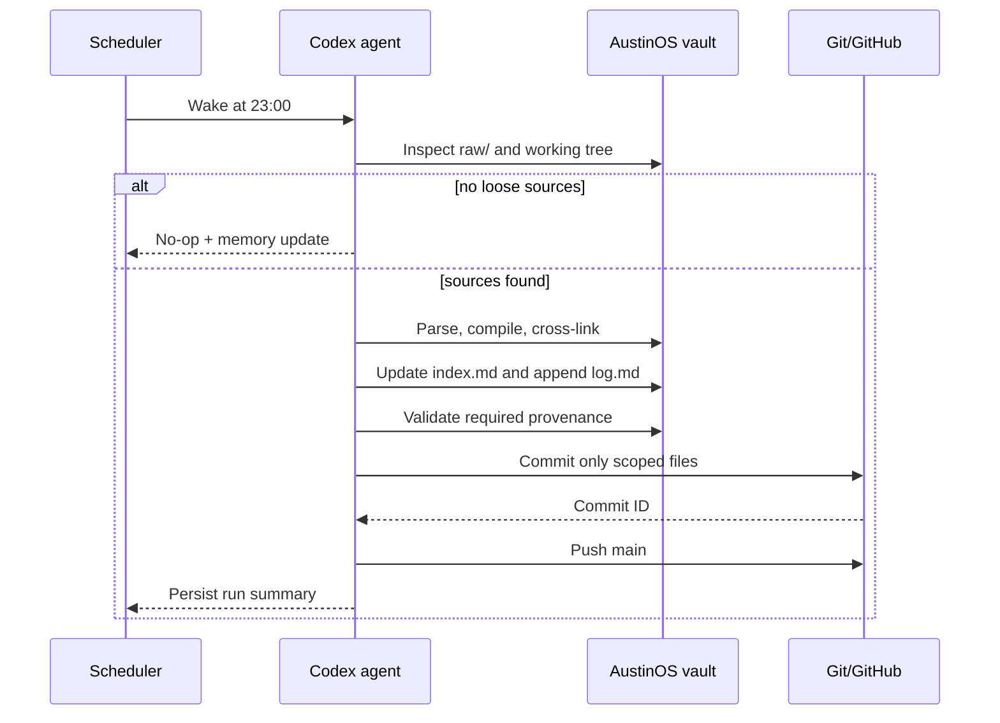
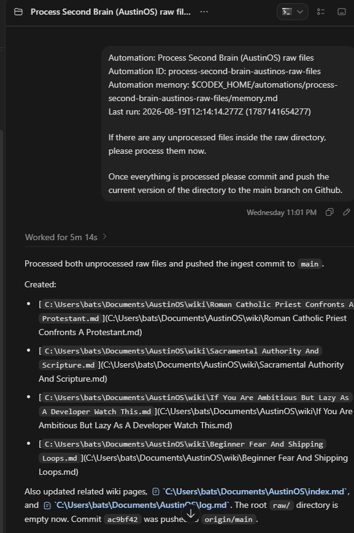
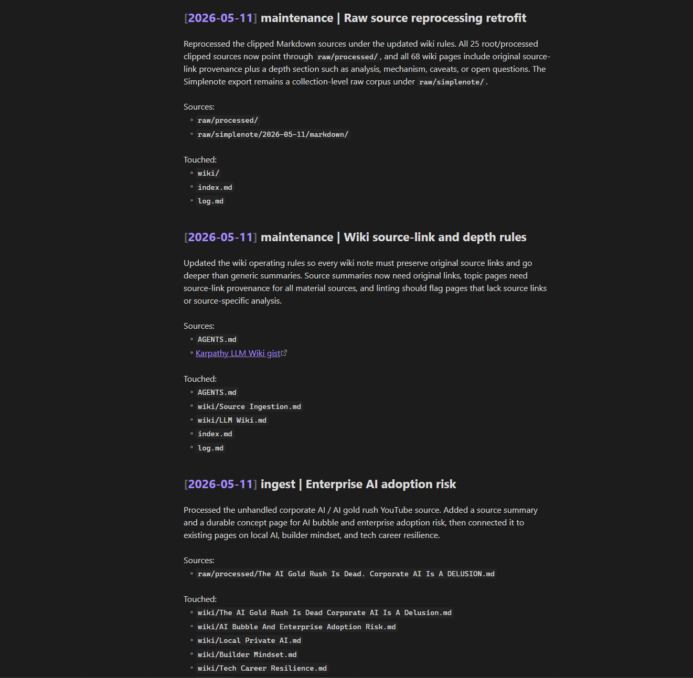

# Automation and Operations

## Active schedule

The production Codex task is named `Process Second Brain (AustinOS) raw files` and is active in the AustinOS project directory.

```toml
kind = "cron"
status = "ACTIVE"
rrule = "RRULE:FREQ=WEEKLY;BYHOUR=23;BYMINUTE=0;BYDAY=SU,MO,TU,WE,TH,FR,SA"
execution_environment = "local"
```

Selecting all seven days makes the effective schedule daily at 23:00. AustinOS operates in Asia/Manila, so the documented runtime is 23:00 PHT unless the host timezone changes.

The sanitized complete example is available at [`examples/automation.example.toml`](../examples/automation.example.toml).

## Runbook



## Operational memory

Automation memory prevents each scheduled task from beginning without context. A production memory entry records:

- run timestamp and timezone;
- source files processed;
- source summaries and durable pages created;
- existing pages updated;
- raw inbox status;
- commit ID and push outcome;
- unrelated files intentionally left untouched.

This is operational metadata, not a substitute for `log.md`. The automation memory explains agent execution; the vault log explains knowledge evolution.

## Git safety

An automated knowledge compiler must not treat the repository as disposable. The AustinOS workflow applies these safeguards:

- inspect status before mutation;
- preserve unrelated Obsidian workspace changes;
- stage only ingest outputs;
- avoid destructive resets;
- create no commit for a no-op run;
- surface push/network failures explicitly;
- leave a recoverable local commit when the remote is unavailable.

## Observed failure modes

Historical captures show two meaningful behaviors:

1. A run found no loose root-level sources and correctly skipped ingestion.
2. A constrained execution environment could create a local commit but could not push because GitHub network access was blocked.

These are useful operational signals. The task does not pretend a remote update occurred when it did not.

## Evidence




