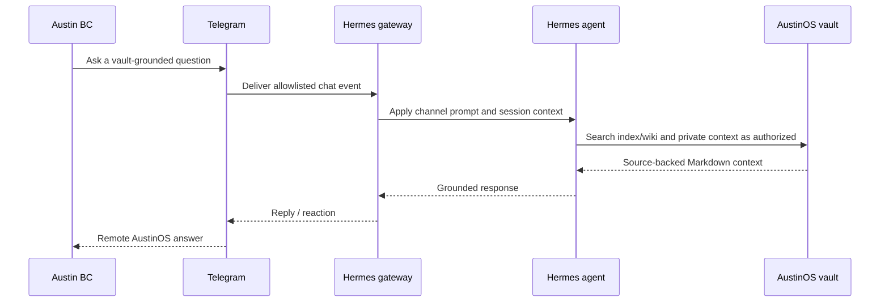
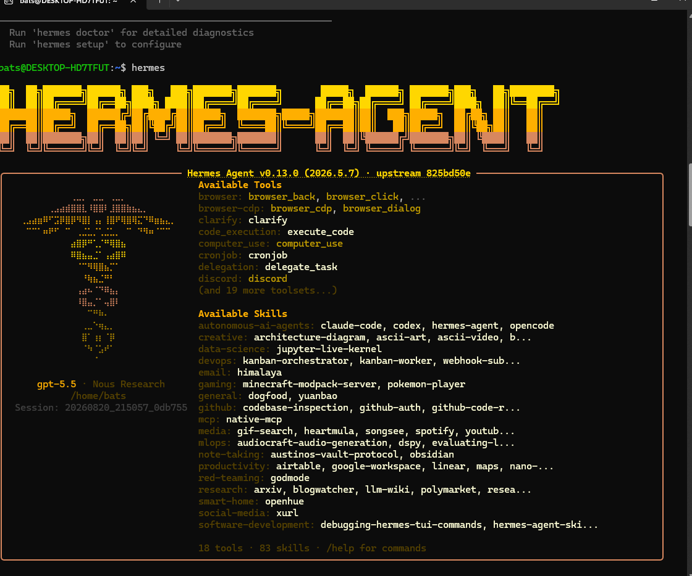
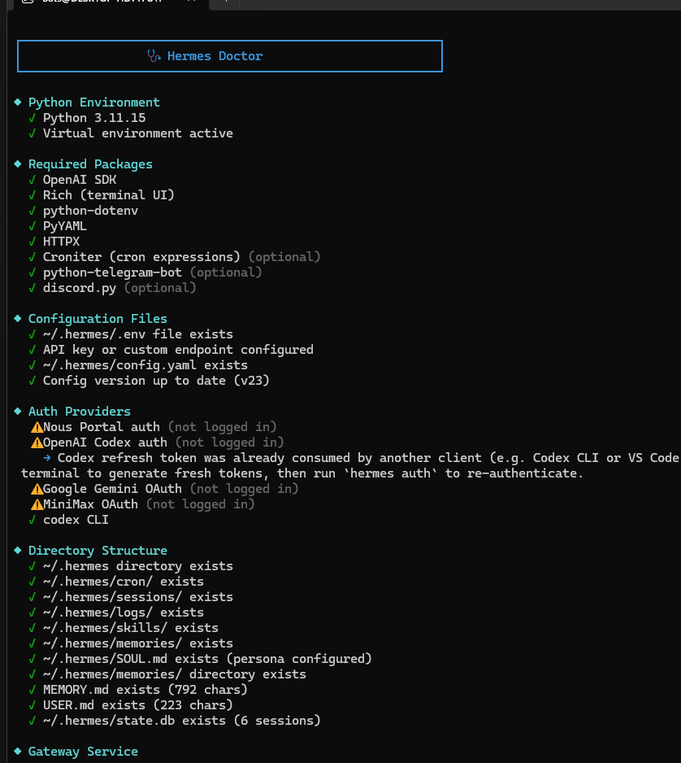
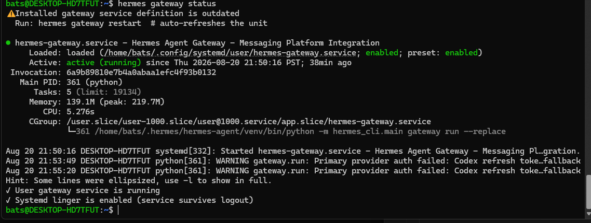

# Hermes Agent and Telegram Access

## Purpose

Obsidian is the local human interface. Hermes adds an agent runtime that can read the same file-first knowledge system, use tools, and communicate through configured messaging channels.

The production environment documented on 2026-08-20 showed:

- Hermes Agent v0.13.0;
- Python 3.11.15 in an isolated environment;
- GPT-5.5 selected through the OpenAI Codex provider;
- Git, ripgrep, Node.js, agent-browser, and multiple agent tools available;
- an `austinos-vault-protocol` note-taking skill;
- `python-telegram-bot` installed;
- a Telegram configuration section containing `allowed_chats`, `channel_prompts`, and `reactions`;
- `hermes-gateway.service` enabled and active as a user service.

## Message path



## Access controls

The public example models three Telegram controls:

- `allowed_chats`: explicit chat IDs permitted to invoke the agent;
- `channel_prompts`: per-channel system behavior and vault-routing guidance;
- `reactions`: lightweight acknowledgment behavior.

Tokens and identifiers belong in environment variables or private configuration. They must never be committed.

## Service model

The gateway is installed as a systemd user unit. This provides:

- automatic restart after process failure;
- startup under the user's service manager;
- standard status and journal inspection;
- separation between interactive Hermes sessions and the persistent messaging gateway.

See [`examples/hermes-gateway.service`](../examples/hermes-gateway.service).

## Diagnostics

The operational workflow uses:

```bash
hermes --version
hermes status
hermes doctor
hermes gateway status
```

`hermes doctor` verifies the Python environment, packages, configuration files, provider state, directory structure, gateway service, external tools, and tool availability. Warnings are treated as degraded capability rather than ignored.

## Evidence







The screenshot containing a temporary OpenAI device-login code was intentionally excluded from this public repository even though the code had expired.
