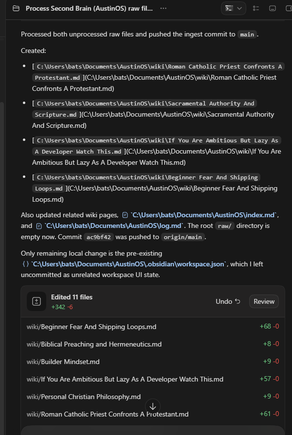

# Ingestion Pipeline

## Contract

The ingest pipeline converts a captured source into both a faithful source representation and reusable knowledge. The production behavior is governed by AustinOS `AGENTS.md`; the public example in `examples/vault/AGENTS.md` demonstrates the portable core.

## Lifecycle

### 1. Discover

Scan the root of `raw/` for loose source files. Collection directories and previously processed files are not treated as new work.

Discovery must be deterministic: the same repository state should produce the same candidate set.

### 2. Classify

Determine the source class and privacy posture before synthesis:

- article, video transcript, repository, note, or export;
- individual source versus collection;
- public, private-context, or restricted material;
- special handling for journal, CRM, belief, health, finance, or security content.

### 3. Parse and preserve provenance

Extract metadata that future readers need for verification:

- title and source type;
- canonical URL when available;
- author/channel and publication date when known;
- literal preserved raw path;
- source-specific claims, mechanisms, examples, caveats, and uncertainties.

### 4. Compile

Create or update the smallest useful set of pages:

- one source summary for a distinct source;
- durable concept/entity/workflow/synthesis pages only when they have standalone reuse value;
- collection-level summaries when hundreds of small notes would create unusable fragmentation.

### 5. Connect

Add explicit Obsidian links in both directions where appropriate. New knowledge should update existing pages when it extends, contradicts, personalizes, or operationalizes them.

### 6. Validate

Every material wiki page should have:

- YAML frontmatter with `type`, `sources`, and `source_links` where applicable;
- source-specific summary and analysis;
- `Original Source Links`;
- clickable `Raw Note Links`;
- an auditable `Sources` section;
- resolvable internal links.

Run:

```bash
python scripts/vault_audit.py /path/to/vault
```

### 7. Publish internal state

Move the handled loose source into `raw/processed/` or its durable collection, update `index.md`, append `log.md`, and create a scoped Git commit.

## Pseudocode

```python
def ingest(vault):
    candidates = discover_loose_sources(vault / "raw")
    if not candidates:
        return NoOp("nothing to process")

    for source in candidates:
        classification = classify(source)
        evidence = parse(source, classification)
        source_page = compile_source_summary(evidence)
        topic_pages = update_durable_topics(evidence, source_page)
        connect(source_page, topic_pages)
        validate_provenance(source_page, topic_pages)
        move_to_processed(source)

    rebuild_index(vault)
    append_log(vault)
    validate_vault(vault)
    commit_scoped_changes(vault)
```

The public scripts implement validation and inventory, not LLM synthesis. Synthesis remains an agent responsibility because it requires source-specific judgment.

## Invariants

1. Raw content is never deleted as a side effect of successful synthesis.
2. A claim must not lose its original external/canonical link.
3. A wiki page must not cite only itself or another generated page when raw evidence exists.
4. Sensitive source content stays private-context unless explicitly requested.
5. The log is appended; prior chronology is not rewritten.
6. Unrelated working-tree changes are not swept into the ingest commit.

## Failure handling

| Failure | Behavior |
|---|---|
| No candidates | Exit successfully without a commit |
| Missing source URL | Preserve the most specific canonical local path |
| Ambiguous privacy class | Keep output private and record the uncertainty |
| Broken internal link | Fail validation before publication |
| Dirty unrelated Git state | Leave unrelated files unstaged and report them |
| Network/push unavailable | Keep the local commit and report that remote state is stale |
| Partial compilation | Do not mark the source processed until required outputs validate |

## Evidence from AustinOS

The supplied automation capture shows an ingest that created four wiki pages, updated related pages plus `index.md` and `log.md`, committed the scoped result, pushed it to `origin/main`, and deliberately left pre-existing Obsidian workspace state uncommitted.


