# Privacy Model

## Boundary

AustinOS is private because it contains personal journals, relationship context, financial and health material, exported conversations, and raw source collections. My Second Brain is public because it contains only the engineering pattern and approved evidence.

```mermaid
flowchart LR
    subgraph Private[AustinOS - private]
        Raw[Raw corpus]
        Journal[Journal]
        CRM[CRM]
        Conversations[Conversation exports]
        Secrets[Tokens and identifiers]
    end

    subgraph Review[Sanitization boundary]
        Inventory[Inventory]
        Redact[Redact / exclude]
        Preflight[Public preflight]
    end

    subgraph Public[My Second Brain - public]
        Architecture[Architecture]
        Scripts[Reference scripts]
        Examples[Fabricated examples]
        Evidence[Approved screenshots]
    end

    Private --> Inventory --> Redact --> Preflight --> Public
```



## Threats

| Threat | Control |
|---|---|
| Accidentally publishing private notes | Block `raw/`, `journal/`, and `crm/` outside the fabricated example vault |
| Credential disclosure | Detect token patterns, `.env`, private keys, bot tokens, and device codes |
| Identity leakage | Use Austin BC as public authorship; omit private contact records |
| Misleading public claims | Separate observed evidence from reconstructed reference code |
| Broken provenance | Require source-link and raw-note sections in example compiled pages |
| Overbroad agent access | Telegram allowlist and channel-specific prompts |

## Screenshot selection

Excluded:

- temporary OpenAI device authorization code;
- blank or accidental crops;
- duplicate graph captures;
- screens dominated by private note titles without additional architectural value.

Included screenshots still show the real operational interface and may contain the local host alias used by Austin BC. They contain no API keys, bot tokens, private keys, or chat identifiers.

## Release check

Run before publishing:

```bash
python scripts/public_preflight.py .
```

This is a defense-in-depth guard, not a guarantee. Human review remains mandatory for screenshots and nuanced personal information.
