# Screenshot Evidence Catalog

All images are user-supplied captures from Austin BC's operational environment. No AI-generated artwork is used.

## Knowledge graph

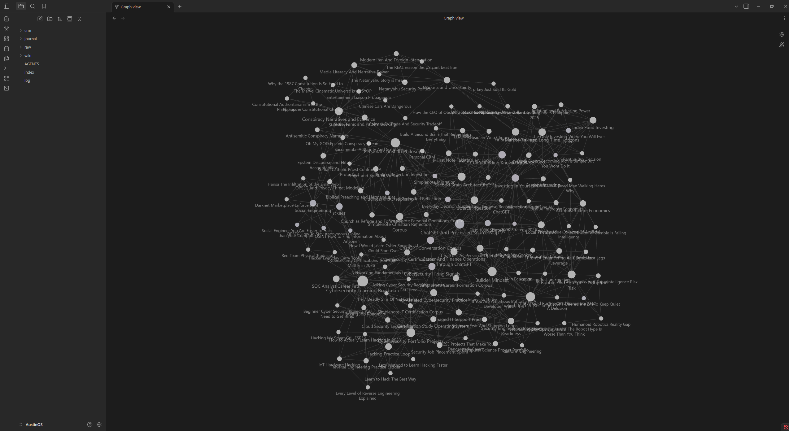

The filtered Obsidian graph shows the compiled wiki as an explicit network rather than an unstructured folder of notes. The left rail exposes the layered vault structure and root control files.

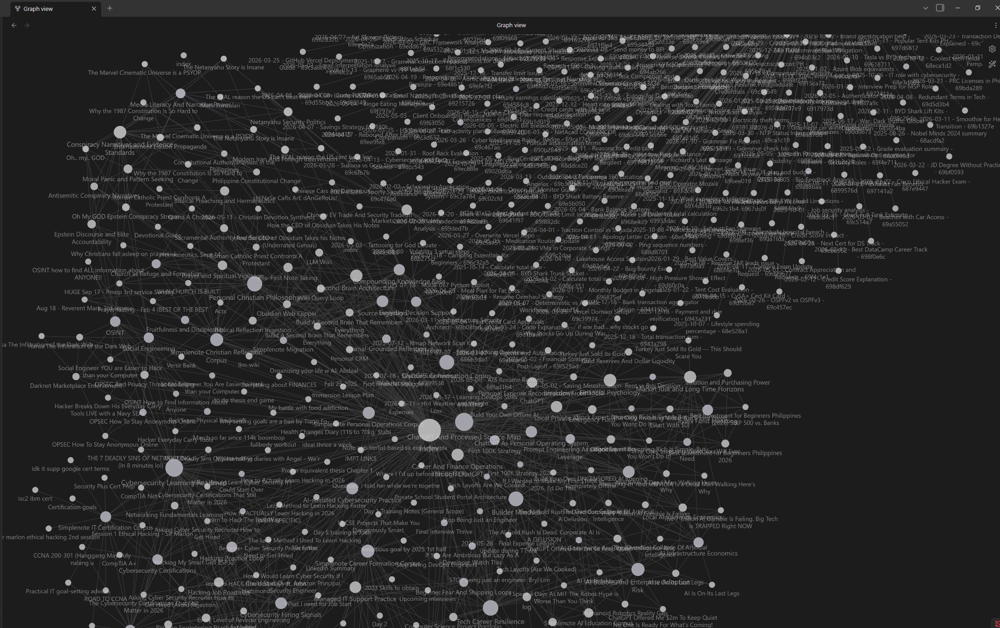

The full graph demonstrates scale across compiled wiki pages and imported conversation material.

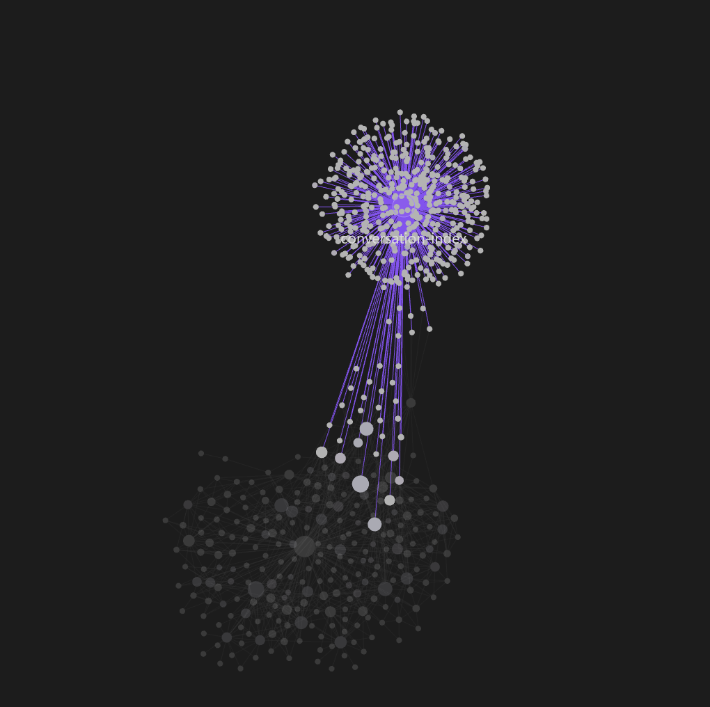

This graph highlights the conversation collection and its links into durable knowledge pages.

## Ingestion and maintenance

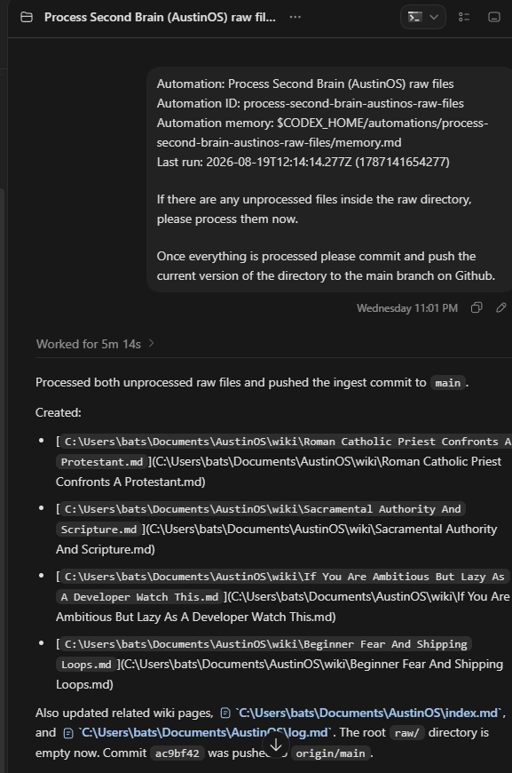

The scheduled Codex task identifies the AustinOS project, remembers prior runs, processes loose raw files, and requests a Git update after successful compilation.

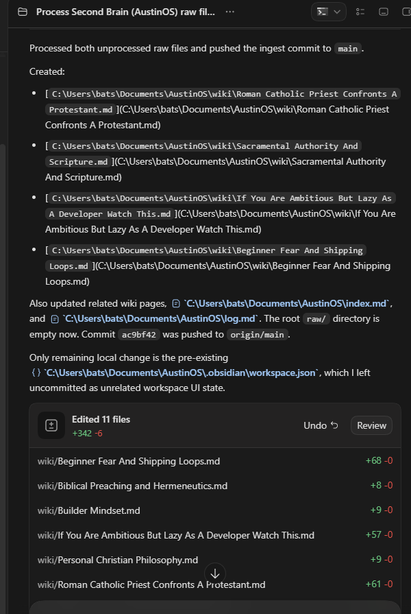

The run summary records created and updated pages, index/log maintenance, the scoped Git commit, and the unrelated Obsidian workspace file intentionally left uncommitted.

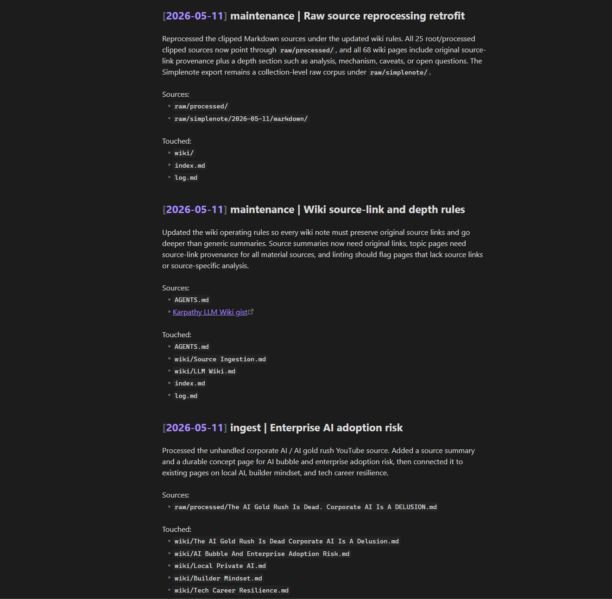

The append-only log records maintenance rationale, sources, and files touched.

## Compiled knowledge

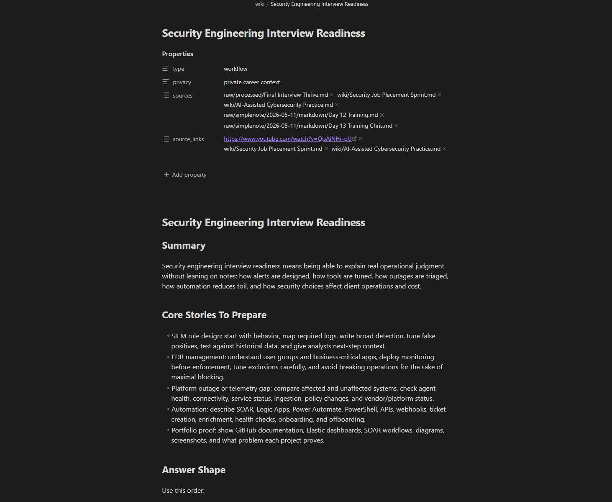

The page demonstrates typed metadata, multiple source paths, source links, structured analysis, and operationally useful content.

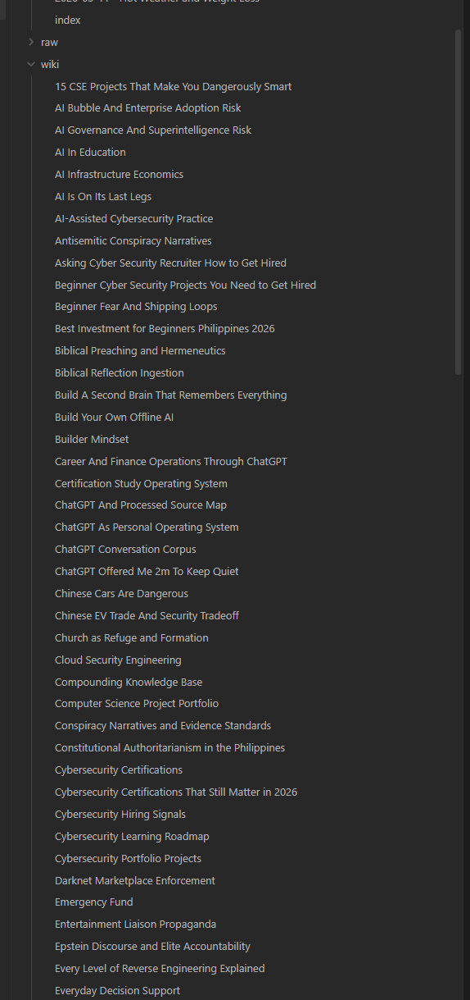

The file catalog shows topic breadth across AI, cybersecurity, finance, career, belief, engineering, and personal operations.

## Agent runtime

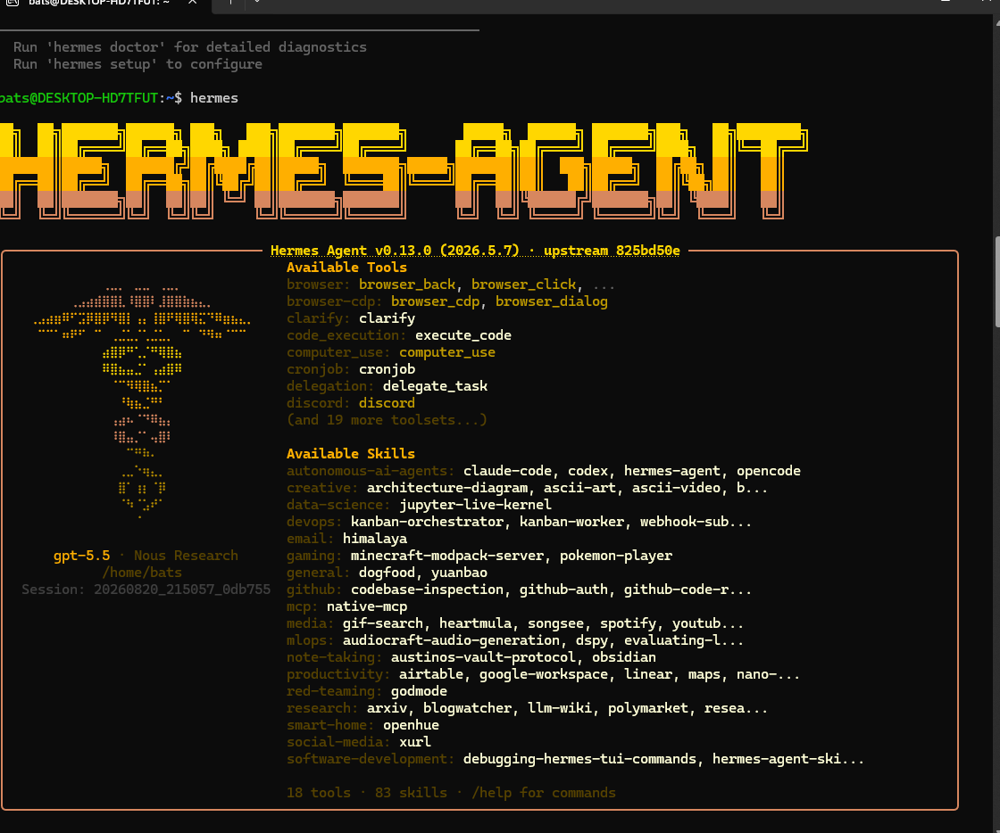

The Hermes TUI shows the selected model/provider, available tools, and the AustinOS vault protocol among installed skills.

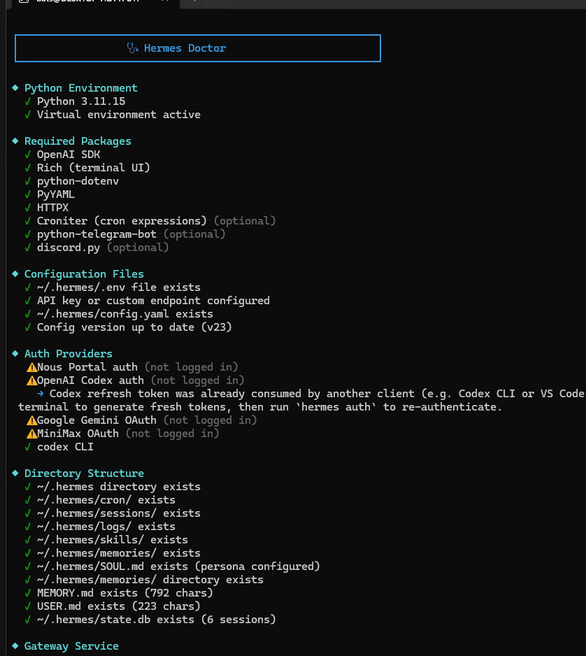

Diagnostics verify environment, packages, configuration, directory structure, and runtime state.

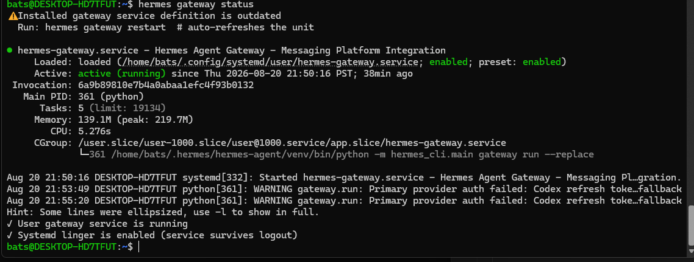

The gateway is loaded, enabled, and active as a user service for messaging-platform integration.

## Intentionally omitted

- the OpenAI device-login screenshot because it contains an authentication code;
- three blank/near-blank captures;
- duplicate setup screens;
- captures that add no technical evidence beyond the selected set.
